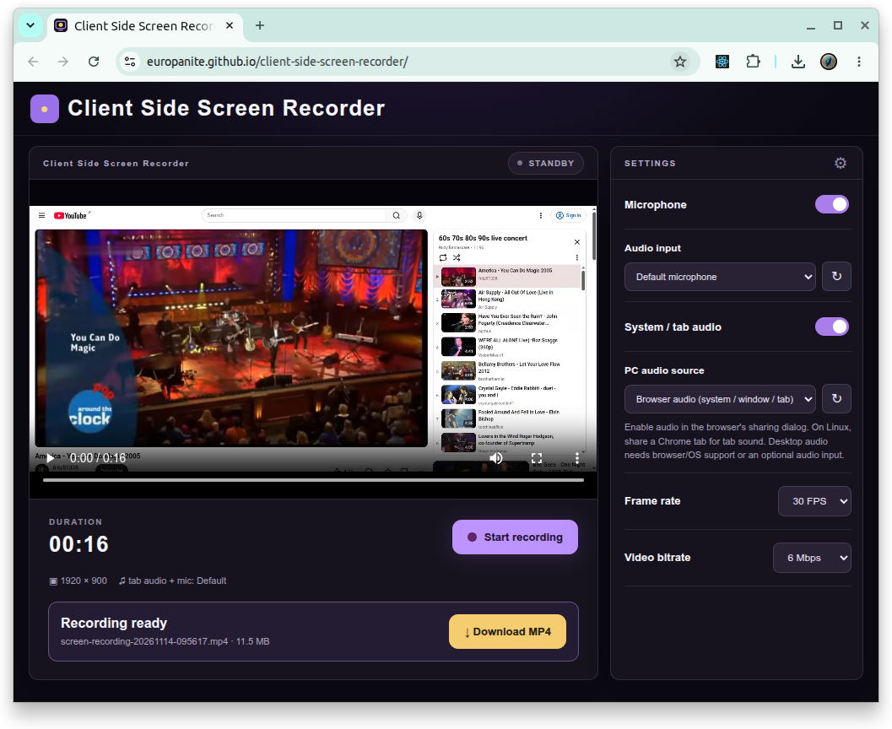

# [Client Side Screen Recorder](https://github.com/europanite/client-side-screen-recorder)

[](https://github.com/europanite/client-side-screen-recorder/actions/workflows/ci.yml)
[](https://github.com/europanite/client-side-screen-recorder/actions/workflows/pages.yml)
[](LICENSE)




## PlayGround

[▶ Open the app](https://europanite.github.io/client-side-screen-recorder/)

Capture your screen, tab, or window and optionally record microphone and supported system/tab audio, entirely in your browser. Export a **MP4**. 

## Features

- Full display, browser tab, or application-window capture via `getDisplayMedia()`.
- Independent microphone and system/tab audio options; both sources are mixed through Web Audio when available.
- Live recording timer, pause/resume, manual stop, and stop when screen sharing ends.
- MP4 preview and local download; customizable target frame rate and H.264 bitrate.
- No recording data is transmitted to a server; static hosting on GitHub Pages.
- Responsive dark UI, GitHub Actions tests/build and Pages publishing.

## Local development

Requires Node.js **22+** and npm. The default PC audio source is **Browser audio (system / window / tab)**, with no virtual device installation required:

Sharing audio is subject to the browser, OS, and the user's selection in the sharing dialog. If no PC or microphone audio track can be acquired, recording continues with available tracks and a warning rather than failing solely because audio is missing.

```bash
cd frontend/app
npm install
npm run dev
# visit http://localhost:5173
```

Build and test:

```bash
cd frontend/app
npm test
npm run typecheck
npm run build
npm run preview
```

Or use Docker:

```bash
docker compose up --build
# Open http://localhost:5173

# Run tests, TypeScript check, and production build in a separate container:
docker compose -f docker-compose.test.yml run --rm --build frontend_test
```


## License

- Apache License 2.0 
